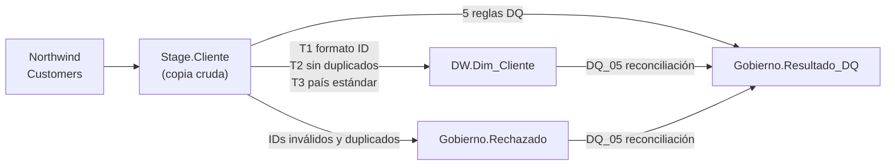

# Linaje de datos

El detalle columna por columna (Origen → Stage → DW) está en [`diccionario_datos.md`](diccionario_datos.md), sección 2.

> Nota: los datos de este proyecto son **sintéticos** (inspirados en Northwind); no se leen de una base Northwind real.
